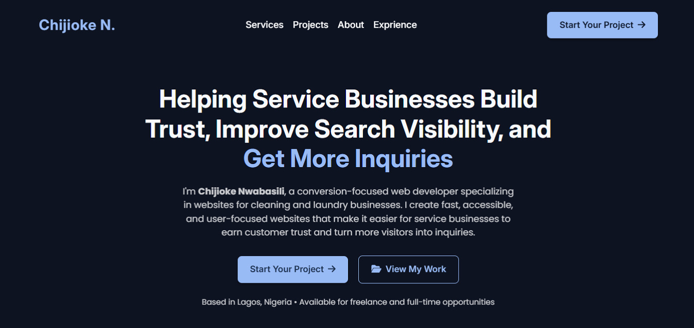

# Chijioke Nwabasili – Portfolio Website

A conversion-focused portfolio website designed to showcase my frontend development skills, featured projects, and approach to building fast, accessible, and user-focused websites.

---

## 📸 Screenshots

### Hero Section

## 🌐 Live Portfolio

[View the live site](https://chijiokenwabasili.vercel.app)

---

## Overview

Many portfolio websites focus on listing skills and projects.

This portfolio takes a different approach.

Rather than simply showcasing technologies, it demonstrates how I apply frontend development, user experience, accessibility, technical SEO, and conversion-focused thinking to build websites that solve real business problems.

The goal is to communicate not only what I build, but how I approach building websites that are clear, fast, and user-focused.

---

## Key Focus Areas

### Conversion-Focused Structure

- Clear value proposition in the hero section
- Featured project case studies
- Strategic calls-to-action
- Simple, intuitive navigation

### Technical SEO

- Semantic HTML
- Optimized metadata
- Open Graph tags
- Twitter Cards
- JSON-LD Person Schema
- Sitemap.xml
- Robots.txt

### User Experience (UX)

- Responsive layouts
- Accessibility best practices
- Clear information hierarchy
- Mobile-first experience
- User-focused navigation

### Performance

- Optimized images
- Lazy loading
- Efficient HTML, CSS, and JavaScript
- Fast-loading pages

---

## Features

- Conversion-focused hero section
- Featured project showcase
- About section
- Professional experience section
- Contact form
- Downloadable resume
- Responsive navigation
- Structured data (JSON-LD)
- Technical SEO implementation
- Accessibility best practices

---

## Tech Stack

- HTML5
- CSS3
- JavaScript
- AOS (Animate On Scroll)

---

## 👤 Author

**Chijioke Nwabasili**

- Portfolio: [chijiokenwabasili.vercel.app](https://chijiokenwabasili.vercel.app)
